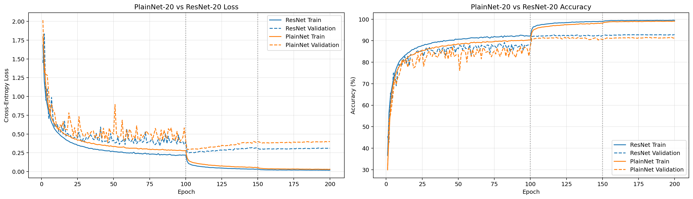

# Part 02 — ResNet-20 from Scratch on CIFAR-10

本项目是个人深度学习经典模型学习计划的 Part 02。目标不是调用 `torchvision.models.resnet*`，而是使用 PyTorch 基础模块从零组装适用于 CIFAR-10 的 ResNet-20，并通过 PlainNet-20 对照实验理解残差连接带来的优化优势。

> 这里的 “from scratch” 指自行实现网络结构、残差块、shortcut、初始化和训练流程；底层卷积、BatchNorm 和自动求导仍由 PyTorch 提供。



## 学习目标

本项目围绕以下问题展开：

- 深层普通网络为什么可能出现 degradation problem？
- 为什么学习残差 \(F(x)=H(x)-x\) 往往比直接学习 \(H(x)\) 更容易？
- identity shortcut 与 projection shortcut 分别适用于什么情况？
- 如何处理 shortcut 两侧的通道数和空间尺寸变化？
- 残差连接如何影响优化速度、稳定性与泛化？
- zero initialization 对残差分支有什么影响？

## 核心原理

普通网络直接学习目标映射：

\[
H(x)
\]

残差网络将其重新参数化为：

\[
H(x)=F(x)+x
\]

当理想变换接近恒等映射时，普通网络需要通过多层卷积拟合 \(H(x)=x\)，而残差分支只需学习：

\[
F(x)\approx0
\]

对于最简残差关系 \(y=x+F(x)\)，反向传播包含：

\[
\frac{\partial L}{\partial x}
=
\frac{\partial L}{\partial y}
+
\frac{\partial L}{\partial y}
\frac{\partial F}{\partial x}
\]

第一项提供了一条不经过残差分支内部卷积层的直接梯度路径。

本项目实现的是 post-activation BasicBlock：

```text
x ─────────────────────────────┐
                               │
x → Conv → BN → ReLU → Conv → BN → Add → ReLU
                               ↑
                         shortcut(x)
```

## 模型结构

### ResNet-20

输入为 CIFAR-10 的 `32 × 32` RGB 图像：

```text
Input                       [N,  3, 32, 32]
3×3 stem                    [N, 16, 32, 32]
Stage 1: 3 BasicBlocks      [N, 16, 32, 32]
Stage 2: 3 BasicBlocks      [N, 32, 16, 16]
Stage 3: 3 BasicBlocks      [N, 64,  8,  8]
AdaptiveAvgPool             [N, 64,  1,  1]
Flatten                     [N, 64]
Linear                      [N, 10]
```

CIFAR-10 图像较小，因此没有使用 ImageNet ResNet 中的 `7×7, stride=2` stem 和初始 MaxPool。

网络深度满足：

\[
6n+2=20,\qquad n=3
\]

因此三个 stage 分别包含 3 个双卷积 BasicBlock。

当输入输出尺寸一致时使用 identity shortcut；当通道数改变或空间尺寸减半时，使用：

```text
1×1 Conv, stride=2 + BatchNorm
```

作为 projection shortcut。

本实现使用 projection shortcut，因此属于 CIFAR-style ResNet-20 变体，并非原论文中使用无参数 Option A shortcut 的逐项复刻。

参数量：

```text
ResNet-20: 272,474
```

### PlainNet-20

PlainNet-20 保留与 ResNet-20 相同的：

- stem
- 三阶段通道配置
- 主分支卷积数量
- 下采样位置
- BatchNorm 和 ReLU
- 全局平均池化与分类器

唯一核心区别是完全移除 shortcut 和残差加法。

参数量：

```text
PlainNet-20: 269,722
```

两个模型相差 2,752 个参数，来自 ResNet 的两个 projection shortcut。

## 初始化

两个模型均使用：

- Conv2d：Kaiming normal initialization
- BatchNorm：\(\gamma=1,\ \beta=0\)
- Linear：小方差正态初始化

ResNet 另外支持：

```python
zero_init_residual=True
```

它会把每个 BasicBlock 最后一个 BatchNorm 的缩放参数初始化为 0，使残差分支初始满足：

\[
F(x)\approx0
\]

## 数据与训练配置

数据集采用 CIFAR-10：

```text
训练集：45,000
验证集： 5,000
测试集：10,000
划分种子：42
```

训练增强：

```text
RandomCrop(32, padding=4, padding_mode="reflect")
RandomHorizontalFlip(p=0.5)
ToTensor
Normalize
```

优化配置：

```text
Optimizer: SGD
Initial learning rate: 0.1
Momentum: 0.9
Weight decay: 1e-4
Epochs: 200
Train batch size: 128
Validation/Test batch size: 256
Scheduler: MultiStepLR
Milestones: [100, 150]
Gamma: 0.1
Loss: CrossEntropyLoss
```

测试集不参与模型选择。训练期间根据验证准确率保存最佳 checkpoint，训练完成后再使用最佳模型进行最终测试。

## 实验结果

| 模型 | 初始化 | 最佳验证准确率 | 最佳 epoch | 测试准确率 |
|---|---|---:|---:|---:|
| PlainNet-20 | 标准 Kaiming + BN | 91.58% | 124 | — |
| ResNet-20 | 标准残差初始化 | 92.48% | 112 | 91.54% |
| ResNet-20 | zero-init residual | **92.88%** | 116 | **91.99%** |

标准初始化下，ResNet-20 的最佳验证准确率比 PlainNet-20 高 0.90 个百分点。

使用 zero initialization 后，ResNet-20 相比自身标准初始化：

```text
验证准确率：+0.40%
测试准确率：+0.45%
```

zero-init ResNet 与 PlainNet 的 1.30% 验证准确率差距同时包含残差连接和初始化策略的影响，不能全部归因于 shortcut。

## 曲线观察

对照曲线显示：

- 在前 100 epochs 的高学习率阶段，ResNet 的训练 loss 通常低于 PlainNet。
- ResNet 的训练准确率通常高于 PlainNet，验证曲线也更加稳定。
- epoch 100 降低学习率后，两个模型均出现明显性能跃升。
- epoch 150 的第二次学习率下降主要继续改善训练集，对验证集提升有限。
- 两个模型最终都能把训练准确率推近 100%，但 ResNet 的验证性能更好。
- 后期训练 loss 继续下降，而验证 loss 回升，说明模型逐渐出现过拟合和高置信度错误。

这些结果支持以下结论：

> 在相同主分支深度下，残差连接改善了优化速度、训练稳定性和验证集泛化表现。

本项目没有训练 PlainNet-56，因此没有严格实验复现“更深 PlainNet 的训练误差反而更高”这一 degradation 现象。更准确的表述是：本实验理解了 degradation 的理论背景，并观察到了与残差优化优势一致的结果。

## 项目结构

```text
part02-resnet/
├── README.md
├── compare_plainnet_resnet.py
├── predict_image.py
├── plainnet_vs_resnet.png
├── my images/
│   ├── cat_1.png
│   ├── cat_2.png
│   ├── deer_1.jpg
│   ├── dog_1.png
│   ├── dog_2.jpg
│   ├── dog_3.jpg
│   ├── plane_1.png
│   ├── plane_2.png
│   ├── plane_3.png
│   ├── ship_1.jpg
│   ├── ship_2.jpg
│   └── ship_3.jpg
├── resnet20/
│   ├── __init__.py
│   ├── resnet20.py
│   ├── train_resnet20.py
│   └── plot_history.py
└── plainnet20/
    ├── plainnet20.py
    ├── train_plainnet20.py
    └── plot_history.py
```

数据集和 checkpoint 不提交到 Git：

```text
data/
*.pt
*.pth
*.ckpt
```

因此克隆仓库后，需要先完成训练，才能运行模型对比和单图推理。

## 环境

本项目开发环境：

```text
Ubuntu / WSL
Python 3.11.15
PyTorch 2.13.0+cu130
NVIDIA RTX 5060 Laptop GPU, 8 GB VRAM
```

主要依赖：

```text
torch
torchvision
matplotlib
Pillow
tqdm
```

可在已有 Python 环境中安装：

```bash
pip install torch torchvision matplotlib pillow tqdm
```

请根据本机 CUDA 环境选择匹配的 PyTorch 版本。

## 运行方式

从仓库根目录进入本项目：

```bash
cd part02-resnet
```

### 1. 检查模型结构

```bash
python resnet20/resnet20.py
python plainnet20/plainnet20.py
```

### 2. 训练 ResNet-20

```bash
python resnet20/train_resnet20.py
```

训练完成后生成：

```text
resnet20/checkpoints/last_checkpoint.pt
resnet20/checkpoints/best_checkpoint.pt
```

### 3. 训练 PlainNet-20

```bash
python plainnet20/train_plainnet20.py
```

训练完成后生成：

```text
plainnet20/checkpoints/last_checkpoint.pt
plainnet20/checkpoints/best_checkpoint.pt
plainnet20/checkpoints/plainnet20_curves.png
```

### 4. 绘制单模型训练曲线

```bash
cd resnet20
python plot_history.py
cd ..
```

或：

```bash
cd plainnet20
python plot_history.py
cd ..
```

### 5. 生成 PlainNet 与 ResNet 对照图

完成两个模型的训练后：

```bash
python compare_plainnet_resnet.py
```

输出：

```text
plainnet_vs_resnet.png
```

当前对照图中的 ResNet checkpoint 来自 `zero_init_residual=True` 实验，因此应理解为：

```text
PlainNet-20 vs ResNet-20 (zero-init)
```

### 6. 单张外部图片推理

```bash
python predict_image.py "my images/cat_1.png"
```

脚本会：

- 加载验证集最优 ResNet-20 checkpoint
- 将外部图片缩放并中心裁剪到 `32 × 32`
- 输出 Top-3 类别和概率
- 保存带预测标题的 `prediction_result.png`

外部自然图片与 CIFAR-10 在分辨率、构图和图像风格上存在分布偏移，因此单图预测结果不等同于 CIFAR-10 测试集性能。

## Checkpoint 内容

训练 checkpoint 包含：

```text
epoch
model_state_dict
optimizer_state_dict
scheduler_state_dict
train_loss
train_accuracy
validation_loss
validation_accuracy
best_validation_accuracy
history
```

PlainNet checkpoint 还保存了模型名称和训练配置。建议 ResNet checkpoint 同样保存：

```python
"architecture": "ResNet20",
"config": {
    "zero_init_residual": True,
    "num_epochs": 200,
    "batch_size": 128,
    "optimizer": "SGD",
    "initial_learning_rate": 0.1,
    "momentum": 0.9,
    "weight_decay": 1e-4,
    "milestones": [100, 150],
    "gamma": 0.1,
    "split_seed": 42,
},
```

## 已掌握内容

通过本项目完成了：

- 理解 degradation problem 与普通过拟合的区别
- 理解残差学习 \(F(x)+x\)
- 从零实现 BasicBlock
- 实现 identity 与 projection shortcut
- 处理通道数和空间尺寸变化
- 从零组装 CIFAR ResNet-20
- 实现 Kaiming 与 residual zero initialization
- 建立训练、验证、测试和 checkpoint 流程
- 构造 PlainNet-20 受控对照
- 分析残差连接对优化和泛化的影响
- 完成单张外部图片推理

## 参考

- Kaiming He et al., [Deep Residual Learning for Image Recognition](https://arxiv.org/abs/1512.03385)
- Kaiming He et al., [Identity Mappings in Deep Residual Networks](https://arxiv.org/abs/1603.05027)

## 说明

这是一个以理解为目标的个人自学项目，而不是追求排行榜成绩的完整训练框架。代码保留了一些显式的尺寸检查和教学性写法，以便观察残差块内部的数据流和梯度路径。